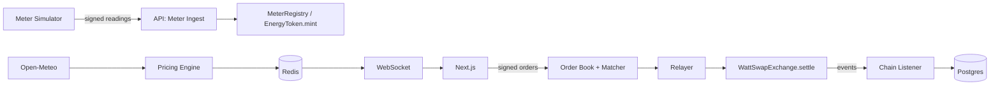

# WattSwap

A peer-to-peer marketplace where rooftop-solar prosumers tokenize surplus energy and sell it to consumers.

> **Testnet demo.** Smart meters are simulated by a labeled meter-simulator service and payment uses a mock
> stablecoin (mUSDC). No physical energy is delivered and no real money is settled.

Core ideas: signed meter readings mint an energy token (WATT, 3 decimals, 1.000 WATT = 1 kWh); a FastAPI
engine re-prices the market from live weather and order-book pressure; trades settle atomically in one
contract call; prices, order book and trades stream to the browser over WebSockets.

**Status:** Phase 3 (pricing engine, on top of the Phase 2 meter-to-mint pipeline). Trading and the full UI arrive in Phases 4-8
(see [CLAUDE.md](CLAUDE.md) for the roadmap and [docs/architecture.md](docs/architecture.md) for the diagram).

## Architecture



## Quickstart

Prerequisites: Node 22+, pnpm 9, uv, Foundry, Docker, GNU Make, Git (on Windows use **Git Bash**).

```bash
make doctor     # verify tools, prints install hints for anything missing
make install    # pnpm + uv + Foundry libs
make up         # postgres, redis, anvil, api, web  (creates .env from .env.example)
```

Then open:

- Web: http://localhost:3000
- API docs: http://localhost:8000/docs · health: http://localhost:8000/health · readiness: `/ready`
- Anvil RPC: http://localhost:8545

`make down` stops the stack; `make logs` tails it.

## Commands

| Command | What it does |
|---|---|
| `make doctor` | Check required tools and versions |
| `make install` | Install all dependencies |
| `make up` / `make down` | Start / stop the Docker stack |
| `make test` | All tests (contracts, api, meter-sim, shared, web) |
| `make lint` | Lint, typecheck and format checks for everything |
| `make fmt` | Auto-format everything |
| `make test-contracts-ci` | Contract tests with the heavy fuzz/invariant profile |
| `make coverage-contracts` | Fail if `contracts/src` line coverage < 100% |
| `make slither` | Slither static analysis (fails on medium/high) |
| `make deploy-local` | Deploy all contracts to local Anvil, export ABIs + addresses to `packages/shared` |
| `make export-abis` | Re-export ABIs/addresses to `packages/shared` |
| `make migrate` | Apply database migrations |
| `make sim` | **Simulated** meter in accelerated demo mode: register a demo meter, then 1 interval / 20 s |
| `make sim-provision` | DEV ONLY: register the demo meter through the API (signs in as Anvil account #5) |
| `make pricing` | Run the pricing engine as its own process (set `PRICING_EMBEDDED=false` on the API) |
| `make backtest ARGS="..."` | Replay the engine over historical Open-Meteo data (price series + volatility stats) |
| `make test-integration` | The end-to-end gate: simulated meter, signed readings, WATT minted on Anvil |
| `make gen-vectors` | Regenerate shared EIP-712 test vectors (`packages/shared/vectors/eip712.json`) |
| `make test-<area>` / `make lint-<area>` | One of `contracts`, `api`, `meter-sim`, `shared`, `web` |

## Smart contracts

`EnergyToken` (WATT), `MeterRegistry`, `PriceOracle`, `MockUSDC` (testnet only) and `WattSwapExchange`.
Settlement and the signed order formats are explained in [docs/settlement.md](docs/settlement.md); security
analysis in [docs/threat-model.md](docs/threat-model.md). Local flow: `make up`, then `make deploy-local`.
`@wattswap/shared` exports typed ABIs and per-chain addresses; Sepolia addresses arrive in Phase 8.

## Backend and meter pipeline

The API (`services/api`) provides SIWE login (12 h JWT cookie, revocable on logout), a meter registry that
registers meters on-chain, and the reading pipeline: a device-signed EIP-712 reading is verified, stored once
(idempotent), and minted by a single-writer worker through `EnergyToken.mint`. Reference:
[docs/api.md](docs/api.md); design: [ADR-005](docs/adr/005-mint-pipeline-idempotency.md),
[ADR-006](docs/adr/006-auth-siwe-jwt-key-separation.md).

Try it end to end on your machine:

```bash
make up && make deploy-local     # stack + contracts on Anvil
make sim                         # SIMULATED meter; one 15-minute interval every 20 s (accelerated, logged as such)
# in another terminal: watch WATT arrive for the demo owner (Anvil account #5)
cast call $(jq -r .anvil.EnergyToken packages/shared/src/addresses.json) "balanceOf(address)(uint256)" \
  0x9965507D1a55bcC2695C58ba16FB37d819B0A4dc
```

Meters are **simulated** (solar geometry + Open-Meteo irradiance + noise) and labeled as such in logs, the API
(`is_simulated`) and the docs. The simulator only talks to the public ingest endpoint, so real hardware would replace
exactly one process. In demo mode simulated time runs ahead of real time until it catches up with the present;
readings are always for completed intervals.

`make sim` provisions a demo meter once (kept in `services/meter-sim/runtime/`, git-ignored). After resetting the chain or database (`docker compose down -v`), delete that folder to provision a fresh one.

The role keys (oracle, registrar, relayer, pricer) must be different addresses; the API will not start otherwise.

## Pricing engine

`services/api/app/pricing` re-prices every market every 15 s from live weather (Open-Meteo), the registered meters'
capacity, the WATT that is tradeable, the time of day and the order book. The model is a pure, deterministic core with
EMA smoothing, a 0.25 %/tick rate limiter and a circuit breaker; every tick stores a breakdown of *why* the price
moved. Each tick is signed as an EIP-712 `PriceQuote`, published to Redis (`price:{marketId}`), persisted to
`price_ticks`, and pushed to `PriceOracle` on a threshold or heartbeat. Prices are **integers in mUSDC base units
(6 decimals) per kWh**; no float ever reaches a signature or a transaction.

* Formulas, parameters, the breaker state machine and a worked full-day trace: [docs/pricing-model.md](docs/pricing-model.md);
  decisions: [ADR-007](docs/adr/007-pricing-engine.md); endpoints: [docs/api.md](docs/api.md).
* Watch it live: `make up && make deploy-local`, register a meter (`make sim-provision`), then
  `curl localhost:8000/api/v1/markets` and `curl localhost:8000/api/v1/markets/<marketId>/price`.
* Demo: set `PRICING_CLOCK_MODE=follow_readings`, then `make sim`. The engine follows the accelerated simulator's clock,
  so weather and the load profile sweep a simulated day and the price moves (quote timestamps stay on real chain time).
* Backtest: `make backtest ARGS="--lat 13.0827 --lon 80.2707 --from 2026-06-01 --to 2026-06-07 --capacity-kw 5 --out series.csv"`.
* Admin (role-gated): edit parameters (validated, audited), watch the breaker, reset it, define regional markets.
* Standalone: `make pricing` or `docker compose --profile pricing up -d pricing`; a Redis leader lock makes several safe.

## Environment variables

Every variable is documented in [.env.example](.env.example). Copy it to `.env` (`make env`); never commit `.env`.
The private keys in the example are the public Anvil defaults for local use only.

## Repository layout

```
contracts/      Foundry project (Solidity ^0.8.24, OpenZeppelin v5)
services/api/   FastAPI backend (uv, Python 3.12)
services/meter-sim/  labeled smart-meter simulator
apps/web/       Next.js 15 frontend
packages/shared/ chain config, ABIs and addresses (TS)
docs/           architecture, phase plans, ADRs
```

## Demo walkthrough

Full walkthrough arrives in Phase 8. Today: `make up`, `make deploy-local`, `make sim` (see *Backend and meter pipeline*).
