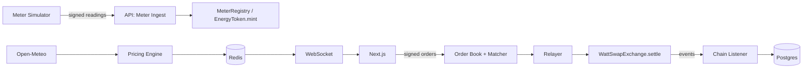

# WattSwap

A peer-to-peer marketplace where rooftop-solar prosumers tokenize surplus energy and sell it to consumers.

> **Testnet demo.** Smart meters are simulated by a labeled meter-simulator service and payment uses a mock
> stablecoin (mUSDC). No physical energy is delivered and no real money is settled.

Core ideas: signed meter readings mint an energy token (WATT, 3 decimals, 1.000 WATT = 1 kWh); a FastAPI
engine re-prices the market from live weather and order-book pressure; trades settle atomically in one
contract call; prices, order book and trades stream to the browser over WebSockets.

**Status:** Phase 1 (smart contracts). Pricing, trading and the full UI arrive in Phases 2-8
(see [CLAUDE.md](CLAUDE.md) for the roadmap and [docs/architecture.md](docs/architecture.md) for the diagram).

## Architecture



## Quickstart

Prerequisites: Node 22+, pnpm 9, uv, Foundry, Docker, GNU Make, Git (on Windows use **Git Bash**).

```bash
make doctor     # verify tools, prints install hints for anything missing
make install    # pnpm + uv + Foundry libs
make up         # postgres, redis, anvil, api, web  (creates .env from .env.example)
```

Then open:

- Web: http://localhost:3000
- API docs: http://localhost:8000/docs · health: http://localhost:8000/health · readiness: `/ready`
- Anvil RPC: http://localhost:8545

`make down` stops the stack; `make logs` tails it.

## Commands

| Command | What it does |
|---|---|
| `make doctor` | Check required tools and versions |
| `make install` | Install all dependencies |
| `make up` / `make down` | Start / stop the Docker stack |
| `make test` | All tests (contracts, api, meter-sim, shared, web) |
| `make lint` | Lint, typecheck and format checks for everything |
| `make fmt` | Auto-format everything |
| `make test-contracts-ci` | Contract tests with the heavy fuzz/invariant profile |
| `make coverage-contracts` | Fail if `contracts/src` line coverage < 95% |
| `make slither` | Slither static analysis (fails on medium/high) |
| `make deploy-local` | Deploy all contracts to local Anvil, export ABIs + addresses to `packages/shared` |
| `make export-abis` | Re-export ABIs/addresses to `packages/shared` |
| `make gen-vectors` | Regenerate shared EIP-712 test vectors (`packages/shared/vectors/eip712.json`) |
| `make test-<area>` / `make lint-<area>` | One of `contracts`, `api`, `meter-sim`, `shared`, `web` |

## Smart contracts

`EnergyToken` (WATT), `MeterRegistry`, `PriceOracle`, `MockUSDC` (testnet only) and `WattSwapExchange`.
Settlement and the signed order formats are explained in [docs/settlement.md](docs/settlement.md); security
analysis in [docs/threat-model.md](docs/threat-model.md). Local flow: `make up`, then `make deploy-local`.
`@wattswap/shared` exports typed ABIs and per-chain addresses; Sepolia addresses arrive in Phase 8.

## Environment variables

Every variable is documented in [.env.example](.env.example). Copy it to `.env` (`make env`); never commit `.env`.
The private keys in the example are the public Anvil defaults for local use only.

## Repository layout

```
contracts/      Foundry project (Solidity ^0.8.24, OpenZeppelin v5)
services/api/   FastAPI backend (uv, Python 3.12)
services/meter-sim/  labeled smart-meter simulator
apps/web/       Next.js 15 frontend
packages/shared/ chain config, ABIs and addresses (TS)
docs/           architecture, phase plans, ADRs
```

## Demo walkthrough

Available from Phase 8. For now the demo is: `make up`, then confirm the web page shows the backend as Online.
