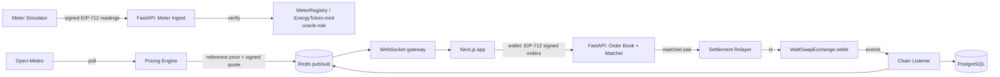

# WattSwap architecture

WattSwap is a **testnet/demo** peer-to-peer marketplace for tokenized surplus solar energy. Smart meters are
simulated by a labeled simulator service and payment uses a mock stablecoin (mUSDC). Nothing here implies
physical energy delivery or real-money settlement.

Phase 0 implements only the scaffold (health endpoints, empty packages, local stack). The diagram below is the
target architecture; each component lands in the phase noted in the roadmap in `CLAUDE.md`.

## System flow



The same flow as text:

1. `[Meter Simulator]` → signed EIP-712 readings → `[FastAPI: Meter Ingest]` → verify → `[MeterRegistry / EnergyToken.mint (oracle role)]`
2. `[Open-Meteo]` → poll → `[Pricing Engine]` → reference price + signed quote → Redis pub/sub → WebSocket → `[Next.js]`
3. `[Next.js + wallet]` → EIP-712 signed orders → `[FastAPI: Order Book + Matcher]`
4. `[Matcher]` → matched pair → `[Settlement Relayer]` → tx → `[WattSwapExchange.settle()]` → events → `[Chain Listener]` → DB + WS

## Components (status after Phase 2)

| Component | Location | Phase 0 | Lands in |
|---|---|---|---|
| Smart contracts | `contracts/` | Five contracts, 100% line coverage; per-meter ordered intervals (ADR-003) | done (Phase 1) |
| API | `services/api/` | SIWE auth, meter registry, reading ingest, mint worker, 8-table schema, error envelope, rate limits, `/ready`, `/metrics` | Phase 2 done; pricing/matching/WS in 3-5 |
| Pricing engine | `services/api/app/pricing/` | Pure model, EMA, limiter, breaker; Open-Meteo per grid cell; signed quotes; Redis feed; oracle pusher; admin API; backtest | done (Phase 3) |
| Meter simulator | `services/meter-sim/` | Solar model, Open-Meteo, EIP-712 signing, accelerated demo mode (labeled SIMULATOR) | done (Phase 2) |
| Web | `apps/web/` | Next.js 15, Tailwind tokens (dark default), shadcn base, health status page | Phase 6 |
| Shared package | `packages/shared/` | Chain ids + empty address book | Phase 1 (ABIs) / 8 (Sepolia) |
| Infra | `docker-compose.yml` | postgres 16, redis 7, anvil, api, web; `meter-sim` behind the `sim` profile | done |

## Local stack

```
browser :3000 ──► web (Next.js) ──► api :8000 ──► postgres :5432
                                         ├──────► redis    :6379
                                         └──────► anvil    :8545 (chain id 31337)
```

Dev keys in `.env.example` are the public Anvil defaults. Production would hold relayer/oracle/pricer keys in a
KMS/HSM.

## Meter-to-mint pipeline (Phase 2)

```
meter-sim (SIMULATED) --POST /api/v1/readings, EIP-712 signed by the device key--> API ingest
   verify: meter active, derived reading_id, device signature, interval bounds, plausibility
           for THIS reading's interval, ordering (DB + on-chain lastIntervalEnd)
   store: readings + mints(pending)    (idempotent: UNIQUE reading_id, per-meter row lock)
mint worker (one leader, Redis lock)
   simulate -> sign -> persist (hash, raw tx) -> broadcast -> wait N confirmations
   -> EnergyToken.mint (oracle key) -> MeterRegistry.recordReading (ordering + plausibility)
   -> ReadingMinted event -> mints.status = confirmed
```

See [ADR-005](adr/005-mint-pipeline-idempotency.md), [ADR-006](adr/006-auth-siwe-jwt-key-separation.md) and
[api.md](api.md).

## Pricing flow (Phase 3)

```
Open-Meteo --(1 batched request / 10 min, per 0.5 degree cell)--> weather store (last good + age)
meters (DB) --> capacity per cell        chain --> WATT held (inventory)        orders --> bids, fills
        \                                   |                                     /
         +--------------------> pricing engine step (pure) <--------------------+
                                   | tick + price drivers
        +--------------+-----------+-------------+------------------+
   price_ticks (DB)  Redis price:{market}   signed PriceQuote     PriceOracle.updatePrice
                     + latest snapshots     (exchange verifies)   (primary market; threshold/heartbeat)
```

See [pricing-model.md](pricing-model.md) and [ADR-007](adr/007-pricing-engine.md).
