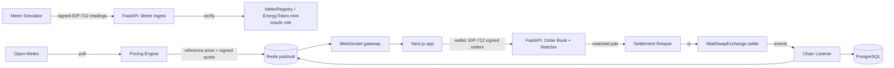

# WattSwap architecture

WattSwap is a **testnet/demo** peer-to-peer marketplace for tokenized surplus solar energy. Smart meters are
simulated by a labeled simulator service and payment uses a mock stablecoin (mUSDC). Nothing here implies
physical energy delivery or real-money settlement.

Phase 0 implements only the scaffold (health endpoints, empty packages, local stack). The diagram below is the
target architecture; each component lands in the phase noted in the roadmap in `CLAUDE.md`.

## System flow



The same flow as text:

1. `[Meter Simulator]` → signed EIP-712 readings → `[FastAPI: Meter Ingest]` → verify → `[MeterRegistry / EnergyToken.mint (oracle role)]`
2. `[Open-Meteo]` → poll → `[Pricing Engine]` → reference price + signed quote → Redis pub/sub → WebSocket → `[Next.js]`
3. `[Next.js + wallet]` → EIP-712 signed orders → `[FastAPI: Order Book + Matcher]`
4. `[Matcher]` → matched pair → `[Settlement Relayer]` → tx → `[WattSwapExchange.settle()]` → events → `[Chain Listener]` → DB + WS

## Components (Phase 0 status)

| Component | Location | Phase 0 | Lands in |
|---|---|---|---|
| Smart contracts | `contracts/` | Foundry project + smoke test | Phase 1 |
| API | `services/api/` | `/health`, `/ready`, `/metrics`, request IDs, JSON logs, Alembic initialised | Phases 2-5 |
| Meter simulator | `services/meter-sim/` | CLI stub (`--help` only) | Phase 2 |
| Web | `apps/web/` | Next.js 15, Tailwind tokens (dark default), shadcn base, health status page | Phase 6 |
| Shared package | `packages/shared/` | Chain ids + empty address book | Phase 1 (ABIs) / 8 (Sepolia) |
| Infra | `docker-compose.yml` | postgres 16, redis 7, anvil, api, web | meter-sim in Phase 2 |

## Local stack

```
browser :3000 ──► web (Next.js) ──► api :8000 ──► postgres :5432
                                         ├──────► redis    :6379
                                         └──────► anvil    :8545 (chain id 31337)
```

Dev keys in `.env.example` are the public Anvil defaults. Production would hold relayer/oracle/pricer keys in a
KMS/HSM.
