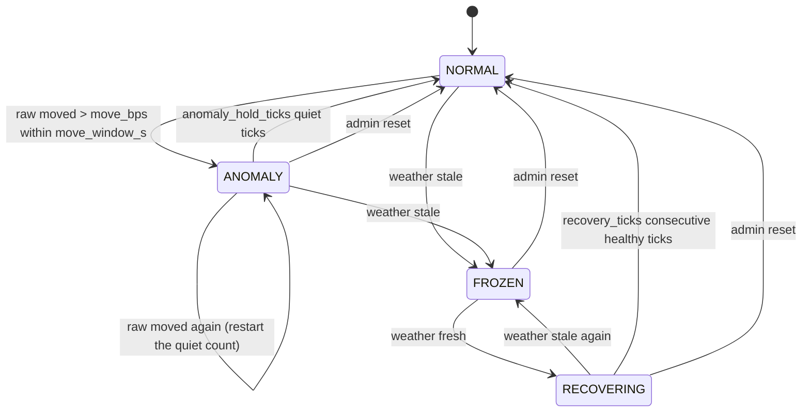

# Pricing model

How WattSwap prices energy: the formulas, every parameter, the circuit breaker, and a worked day.
The engine is a **pure, deterministic function** (`app/pricing/engine.py::step`): the same inputs always
give a byte-identical tick. All I/O (weather, database, Redis, chain) lives at the edges.

> Testnet demo. Meters are simulated and the payment token is a mock stablecoin. Prices here are
> test-network numbers; nothing in this document implies physical delivery or real-money settlement.

## Units

| Quantity | Unit | Type in code |
|---|---|---|
| Price | mUSDC base units (6 decimals) **per kWh**. `150000` = 0.150000 mUSDC/kWh | `int` |
| Energy in orders and inventory | **Wh** (WATT base units; 1.000 WATT = 1 kWh) | `int` |
| Power inside the model | kW (average over a stated horizon) | `Decimal` |
| Irradiance | W/m² (`shortwave_radiation`) | `Decimal` |

Everything computed is a `Decimal` (28 digits, round-half-even, fixed context) and the only thing that leaves
the model as money is an **integer**. Floats exist only where Open-Meteo's JSON is parsed and are converted with
`Decimal(str(x))` immediately. Nothing signed or sent on-chain can be a float: `PriceQuote` refuses anything
that is not a plain `int`, and the parameter API refuses JSON floats.

## Pipeline

```
Open-Meteo ──(1 batched request / 10 min)──► per-cell weather ─┐
meters (DB): capacity per 0.5° cell ───────────────────────────┤
tradeable inventory (open sells, else WATT held) ──────────────┼──► supply S  ─┐
order book: open bids, recent fills ───────────────────────────┤               ├─► ratio D/S_eff ─► P_raw ─► breaker
load profile × local solar time ───────────────────────────────┴──► demand D  ─┘                     │
                                                                                                    ▼
                                      applied price ◄── rate limiter ◄── EMA ◄── (held while FROZEN)
                                            │
                          signed PriceQuote ─┼─► Redis (price:{market}) ─► WebSocket (Phase 5)
                                             ├─► price_ticks (with the price-drivers breakdown)
                                             └─► PriceOracle (threshold / heartbeat)
```

## Formulas

Let one market contain grid cells *c* (0.5° × 0.5°, from the meters' `lat_e6/lon_e6` with integer math), each
with installed capacity `cap_c` (kW) and weather `G_c` (W/m², `shortwave_radiation`), `T_c` (°C, `temperature_2m`).

1. **Cell temperature**  `T_cell = T_c + 0.03 · G_c`
2. **Temperature derate**  `derate = 1 − 0.004 · max(0, T_cell − 25)`
3. **Generation forecast**  `Gen = Σ_c  cap_c · (G_c / 1000) · PR · derate_c`  (PR = 0.80, `performance_ratio`)
4. **Tradeable inventory**  `I = open sell volume` once the order book has any, otherwise the WATT held by the
   owners of the market's active meters (`balanceOf`, cached 30 s). In kW: `I_kW = inventory_kWh / inventory_horizon_hours`.
5. **Effective supply**  `S = w_gen · Gen + w_inv · I_kW`, floored: `S_min = max(s_min_kw, s_min_frac · installed_kW)`,
   `S_eff = max(S, S_min)`. The floor means the ratio never divides by ~0.
6. **Demand**  `D = D_load + D_bids + D_velocity` where
   `D_load = Σ_c  profile(local_solar_hour_c) · demand_scale · cap_c  +  base_demand_kw · profile(mean)`,
   `D_bids = open_bid_kWh / bid_horizon_hours`,
   `D_velocity = velocity_weight · recent_fill_kWh / velocity_window_hours`.
   `local_solar_hour = (UTC hour + longitude/15) mod 24`; `profile` is linear between 24 hourly points.
7. **Raw price**  `P_raw = P_base · (min(D / S_eff, ratio_cap)) ^ ε`, rounded half-even to an integer and clamped
   to `[P_floor, P_ceiling]`. If the market is completely empty (no meters, no inventory, no demand) the ratio is 1,
   so the price is `P_base`.
8. **EMA**  `EMA_t = α · P_raw,t + (1 − α) · EMA_{t−1}` (seeded with the first raw price).
9. **Rate limiter**  `P_t` moves from `P_{t−1}` toward `round(EMA_t)` by at most
   `floor(P_{t−1} · max_step_bps / 10000)`. The floor makes integer rounding fall toward `P_{t−1}`, so the limit
   is never exceeded even by one unit.
10. **Realized volatility**  `σ = sqrt(mean(r²)) · sqrt(ticks per hour) · 10 000` (bps per √hour), with
    `r_i = ln(P_i / P_{i−1})` over the last `vol_window` ticks; published on every tick and as a Prometheus gauge.

Because demand is proportional to the installed base by default (consumers are modelled as the prosumers
themselves), **adding meters raises supply but leaves the raw price unchanged** when nobody holds inventory.
The price reacts to inventory, weather, the time of day and the order book. Set `base_demand_kw` above 0 to model
consumers who do not own panels: then more supply makes energy cheaper.

### Worked example: noon, and why the night is not the ceiling

One 5 kW meter at longitude 0°, 24 kWh of WATT held, `P_base = 150 000`, `ε = 0.6`.

**Noon**, GHI = 900 W/m², 30 °C, local solar hour 12:

| Step | Calculation | Result |
|---|---|---|
| Cell temperature | 30 + 0.03 · 900 | 57 °C |
| Derate | 1 − 0.004 · (57 − 25) | 0.872 |
| Generation | 5 · 0.9 · 0.80 · 0.872 | **3.1392 kW** |
| Inventory | 24 kWh / 12 h = 2 kW; × w_inv 0.5 | 1.0 kW |
| Supply `S_eff` | 3.1392 + 1.0 (floor 0.5 not binding) | **4.1392 kW** |
| Demand | profile(12) 0.70 · 0.35 · 5 | **1.225 kW** |
| Ratio | 1.225 / 4.1392 | 0.29595 |
| Raw price | 150 000 · 0.29595^0.6 | **72 248** (0.072248 mUSDC/kWh) |

**Midnight**, no sun, same inventory: generation 0, `S_eff` = 1.0 kW, demand 0.55 · 0.35 · 5 = 0.9625 kW,
ratio 0.9625, raw = 150 000 · 0.9625^0.6 = **146 599**: the night price is driven by the inventory that is left.

**Midnight with nobody holding any WATT**: `S = 0`, so the floor applies: `S_eff = S_min = 0.5 kW` (10 % of 5 kW),
ratio 1.925, raw = **222 203**. Scarce, so higher than the stocked night, but nowhere near the 600 000 ceiling.

**Absurd demand** (100 kWh of open bids in an hour): ratio capped at 10, raw = 150 000 · 10^0.6 = **597 161**,
still below the ceiling; with `p_ceiling = 500 000` it would be reported as clamped (`raw_ceiling`).

## Smoothing, and why the limiter and the breaker agree

The breaker looks at the **raw** price; users see the **applied** (smoothed, limited) price. For the two to be
consistent, the limiter on its own must never be able to move the applied price as far as the breaker's trigger
within the breaker's window, otherwise the limiter's own movement would look like an anomaly.

With `max_step_bps = 25`, a 15 s tick and a 600 s window (**40 ticks**) the worst case is

```
up   : 1.0025^40 − 1 = 10.50 %  → 1051 bps   (rounded up)
down : 1 − 0.9975^40 =  9.53 %  →  953 bps
trigger: move_bps = 1500 (15 %)      1051 < 1500  ✓
```

This is enforced, not just documented: `cross_check()` rejects any parameter set (admin API, backtest, defaults at
boot) for which `max(up, down) ≥ move_bps`, and the service refuses to start at a tick rate for which the default
parameters fail it (for example `PRICING_TICK_SECONDS=1`). Tests prove it three ways: the closed form, an executed
worst case (a raw price pinned at the opposite bound for thousands of ticks), and a property test over arbitrary
raw sequences. Boundary: with the default 600 s window and 15 s tick, 34 bps is the largest accepted step (worst case 1455 bps); 35 bps reaches 1500 bps and is refused.

## Circuit breaker

A small state machine evaluated every tick (`app/pricing/breaker.py`).



| State | Applied price | Band hint (`band_bps`) | Meaning |
|---|---|---|---|
| `NORMAL` | repriced every tick | `band_hint_bps` (150) | healthy |
| `ANOMALY` | **still repriced** (EMA + limiter) | widened: `band_hint_bps × band_widen_multiplier` (450) | the raw price jumped; an `anomaly_start` event is logged and stored |
| `FROZEN` | **held** at the last price (EMA not advanced) | widened | weather older than `weather_stale_after_s` (30 min), or no weather at all |
| `RECOVERING` | **held** | widened | weather is fresh again; waiting out the hysteresis |

Transitions and their triggers:

| From → To | Trigger | Event emitted |
|---|---|---|
| NORMAL → ANOMALY | raw price differs from any raw sample in the last `move_window_s` by **more than** `move_bps` (strict) | `anomaly_start` |
| ANOMALY → ANOMALY | the condition holds again | (none; quiet counter resets) |
| ANOMALY → NORMAL | `anomaly_hold_ticks` ticks without the condition | `anomaly_end` |
| any → FROZEN | any cell with installed capacity has weather older than `weather_stale_after_s`, or none | `breaker_frozen` |
| FROZEN → RECOVERING | all such weather is fresh | `breaker_recovering` |
| RECOVERING → NORMAL | `recovery_ticks` (8) consecutive healthy ticks | `breaker_recovered` |
| RECOVERING → FROZEN | stale again (hysteresis restarts) | `breaker_frozen` |
| any → NORMAL | `POST /api/v1/admin/pricing/breaker/reset` (applied on the next tick) | `breaker_reset_requested` |

Notes. A raw-price move **never freezes** trading: it widens the hint and logs an event. Only *stale weather*
freezes, because then the model's inputs are not trustworthy. The engine cannot change the on-chain exchange
band (an admin transaction), so the published `band_bps` hint is always capped at the on-chain `bandBps`.
While frozen the engine keeps signing quotes with a fresh timestamp and the held price, so the exchange does not
reject them as stale; `halt_quotes_on_freeze` stops signing instead (trading then halts when the last quote ages
out of `maxStaleness`).

## A full day, step by step

Synthetic day (`uv run python -m app.pricing.trace`; a test fails if this table and the engine disagree):
one 5 kW meter, 24 kWh held all day, clear-sky irradiance from an hourly table (sunrise ≈ 06:00, noon peak
900 W/m², sunset ≈ 19:00), air temperature 22 + 8 · GHI/900 °C, a **sudden cloud** 12:30–13:15 that cuts
irradiance to 25 %, one tick every 15 s.

| point               | time     | ghi     | S_eff_kw | D_kw     | raw    | ema        | applied | limiter | breaker | band_bps | raw_move_bps |
|---------------------|----------|---------|----------|----------|--------|------------|---------|---------|---------|----------|--------------|
| midnight            | 00:00:00 | 0.000   | 1.000000 | 0.962500 | 146599 | 146599.000 | 146599  | -       | NORMAL  | 150      | 0            |
| sunrise             | 06:30:00 | 165.000 | 1.650980 | 1.531250 | 143375 | 143701.479 | 143701  | -       | NORMAL  | 150      | 234          |
| noon                | 12:00:00 | 900.000 | 4.139200 | 1.225000 | 72248  | 72257.865  | 72258   | -       | NORMAL  | 150      | 14           |
| cloud onset (+15 s) | 12:30:15 | 222.479 | 1.848679 | 1.207354 | 116165 | 87865.884  | 72305   | up      | ANOMALY | 450      | 6148         |
| cloud (+10 min)     | 12:40:00 | 221.667 | 1.845768 | 1.201667 | 115946 | 115963.775 | 79679   | up      | ANOMALY | 450      | 19           |
| cloud ends (+0 s)   | 13:15:00 | 860.000 | 4.021084 | 1.190000 | 72246  | 107343.692 | 112374  | down    | ANOMALY | 450      | 3780         |
| anomaly cleared     | 14:00:00 | 800.000 | 3.840178 | 1.190000 | 74269  | 74222.018  | 74222   | -       | NORMAL  | 150      | 63           |
| sunset              | 18:30:00 | 40.000  | 1.160000 | 1.968750 | 206030 | 205375.437 | 205375  | -       | NORMAL  | 150      | 319          |

Reading the table:

* **Midnight** – no sun; the price is the inventory-driven 146 599 (hand-computed above). The first tick has no
  history, so the applied price equals the raw price.
* **Sunrise (06:30)** – generation appears, supply grows, the raw price is already falling; the applied price
  follows it by EMA, well inside the limiter (`limiter` is `-`).
* **Noon** – raw 72 248 (hand-computed above); the smoothed price has converged to it.
* **Cloud onset (+15 s)** – generation collapses to a quarter, so the raw price jumps from 72 248 to 116 165
  (**+6148 bps** in one tick). The breaker moves `NORMAL → ANOMALY`, the band hint widens to 450 bps and an
  `anomaly_start` event is stored. The applied price barely moves: the limiter holds it to +0.25 % per tick.
* **Cloud +10 min** – raw is flat at ≈ 115 900 and the applied price has climbed at the maximum rate (`limiter: up`),
  still far below raw: this is the damping working. The state is still `ANOMALY`.
* **Cloud ends** – raw drops back to 72 246 immediately, but the applied price (112 374) is still catching up and now
  falls at the limiter's maximum rate (`limiter: down`). The anomaly stays active because the raw price moved again.
* **Anomaly cleared (14:00)** – the raw price has been quiet for `anomaly_hold_ticks`; `NORMAL`, band hint back to 150,
  and the applied price has converged on raw.
* **Sunset (18:30)** – generation gone, evening demand peak; raw 206 030, applied 205 375. Elevated, not the ceiling.

Across the whole day: the applied price never leaves `[20 000, 600 000]` (it stays between 71 946 and 227 846), no tick
changes it by more than 25 bps, and no 10-minute window of the applied price moves by 15 %.

### The same day with a weather outage (10:00–12:00)

Weather stops refreshing at 10:00 and ages. At **10:30:15** it is older than 30 minutes: `breaker_frozen`, the
applied price is held at 74 878, the band hint widens, quotes keep being signed. At **12:00:00** weather is fresh:
`breaker_recovering`; seven `RECOVERING` ticks follow (price still held), and at **12:01:45** (the eighth healthy
tick) `breaker_recovered`: repricing resumes, through the limiter. One `breaker_frozen` and one `breaker_recovered`
event are recorded.

## Price drivers (stored with every tick)

Each tick carries a `drivers` object (JSONB in `price_ticks.drivers`, also on the Redis feed and
`GET /api/v1/markets/{id}/price`) so the Market Insights page can explain a move. All numbers are strings or ints.

| Key | Contents |
|---|---|
| `supply` | `generation_kw`, `inventory_kw`, `w_gen`, `w_inv`, weighted terms, `supply_kw`, `s_min_kw`, `effective_kw`, `floor_applied`, `installed_kw`, `inventory_wh`, `inventory_source` (`open_sells` / `held_balances` / `db_minted_fallback`) |
| `demand` | `load_kw`, `base_kw`, `bids_kw`, `velocity_kw`, `demand_kw`, `open_bid_wh`, `recent_fill_wh` |
| `price` | `ratio_uncapped`, `ratio`, `ratio_capped`, `neutral`, `epsilon`, `p_base`, `raw_unclamped`, `raw` |
| `smoothing` | `ema` (display) and `ema_exact` (restart state), `alpha`, `target`, `previous`, `applied`, `held`, `limiter {applied, direction, max_up, max_down, max_step_bps}` |
| `clamps` | which bounds acted: `s_min`, `ratio_cap`, `raw_floor`, `raw_ceiling`, `limiter_up`, `limiter_down`, `final_floor`, `final_ceiling`, `held` |
| `weather` | per cell: `cell`, `meters`, `capacity_w`, `ghi_wm2`, `temp_c`, `cloud_cover_pct`, `cell_temp_c`, `derate`, `generation_kw`, `age_s`, `source` (`live` / `last_good` / `archive` / `none`) |
| `breaker` | `mode`, `reason`, `since`, `healthy_ticks`, `quiet_ticks`, `weather_stale`, `stale_detail`, `raw_move_bps`, `move_limit_bps`, `move_window_s` |
| `band` | `hint_bps`, `published_bps`, `onchain_band_bps`, `widened` |
| `attribution` | change in the raw price versus the previous tick, split between demand and supply, and supply between generation and inventory |
| `market_time`, `local_solar_hour`, `profile_multiplier` | the clock the model used |

**Attribution.** Because `P_raw ∝ (D/S_eff)^ε`, `Δ ln P_raw = ε · (Δ ln D − Δ ln S_eff)` while no cap or clamp binds.
The tick reports `from_demand_bps = ε · Δ ln D · 10⁴`, `from_supply_bps = −ε · Δ ln S_eff · 10⁴`, and splits the
supply part between generation and inventory in proportion to their weighted changes. It is flagged
`approximate` when a cap or clamp is active. Example (tested): 1 kWh of new open bids on a 0.9625 kW night adds
`0.6 · ln(1.9625/0.9625) · 10⁴ = 4 274.6 bps` from demand and nothing from supply.

## Parameters

Every parameter is stored in the database (admin API), has a default, a bound and an audit trail. Values are
layered *defaults ← global (`*`) ← per-market*. Changes take effect within a few seconds. Decimals are sent as
strings; JSON floats are rejected.

| Parameter | Meaning | Default | Allowed range | Unit |
|---|---|---|---|---|
| `p_base` | Neutral price when demand equals supply | `150000` | 1 .. 1000000000000 | mUSDC µ/kWh |
| `p_floor` | Lowest price ever quoted (must allow a >= 1 unit step) | `20000` | 10000 .. 1000000000000 | mUSDC µ/kWh |
| `p_ceiling` | Highest price ever quoted | `600000` | 1 .. 1000000000000 | mUSDC µ/kWh |
| `epsilon` | Price elasticity of the demand/supply ratio | `0.6` | 0.05 .. 3 | - |
| `performance_ratio` | PV system performance ratio | `0.80` | 0.3 .. 1 | - |
| `cell_temp_rise` | Cell temperature rise per W/m2 of irradiance | `0.03` | 0 .. 0.1 | °C per W/m2 |
| `temp_coeff` | Power loss per °C of cell temperature above 25 °C | `0.004` | 0 .. 0.02 | per °C |
| `w_gen` | Weight of forecast generation in effective supply | `1.0` | 0 .. 10 | - |
| `w_inv` | Weight of tradeable inventory in effective supply | `0.5` | 0 .. 10 | - |
| `inventory_horizon_hours` | Window over which inventory kWh is spread to kW | `12` | 0.5 .. 72 | h |
| `s_min_kw` | Absolute floor on effective supply | `0.1` | 0.001 .. 1000000 | kW |
| `s_min_frac` | Floor on effective supply as a fraction of installed capacity | `0.10` | 0 .. 1 | - |
| `ratio_cap` | Cap on demand/supply | `10` | 1 .. 1000 | - |
| `demand_scale` | Baseline load as a fraction of installed capacity | `0.35` | 0.01 .. 10 | - |
| `base_demand_kw` | Market demand independent of installed PV capacity | `0` | 0 .. 1000000 | kW |
| `load_profile` | 24 hourly demand multipliers by local solar hour | `24 hourly multipliers (see below)` | 0 .. 10 | - |
| `bid_horizon_hours` | Open bid kWh are spread over this window | `1` | 0.1 .. 72 | h |
| `velocity_weight` | Weight of recent fill velocity in demand | `0.5` | 0 .. 10 | - |
| `velocity_window_hours` | Look-back window for fill velocity | `1` | 0.1 .. 72 | h |
| `ema_alpha` | EMA smoothing factor (1 = no smoothing) | `0.2` | 0.01 .. 1 | - |
| `max_step_bps` | Maximum price change per tick | `25` | 1 .. 500 | bps |
| `vol_window` | Ticks in the realized-volatility window | `40` | 5 .. 10000 | ticks |
| `weather_stale_after_s` | Weather older than this freezes repricing | `1800` | 300 .. 86400 | s |
| `move_bps` | RAW price move that raises an anomaly | `1500` | 100 .. 10000 | bps |
| `move_window_s` | Window for the anomaly move test | `600` | 60 .. 86400 | s |
| `anomaly_hold_ticks` | Quiet ticks before an anomaly clears | `40` | 1 .. 10000 | ticks |
| `recovery_ticks` | Healthy ticks required to leave FROZEN | `8` | 1 .. 10000 | ticks |
| `band_hint_bps` | Published band hint in normal operation | `150` | 1 .. 10000 | bps |
| `band_widen_multiplier` | Band hint multiplier while anomalous or frozen | `3` | 1 .. 20 | - |
| `halt_quotes_on_freeze` | Stop signing quotes while FROZEN (trading halts when they go stale) | `False` | - | - |
| `tick_seconds` | Seconds between ticks | `15` | 1 .. 3600 | s |

`load_profile` defaults (index = local solar hour, linear in between):
`0.55 0.52 0.50 0.50 0.52 0.60 | 0.80 0.95 0.90 0.80 0.72 0.70 | 0.70 0.68 0.68 0.72 0.80 0.95 | 1.10 1.15 1.05 0.90 0.75 0.62`.
`tick_seconds` is set by `PRICING_TICK_SECONDS`, not through the API. Cross-parameter rules checked on every update:
`p_floor < p_base < p_ceiling`; `p_floor · max_step_bps ≥ 10 000` (a step is at least one unit); `w_gen + w_inv > 0`;
and the limiter/breaker rule above.

## Weather, regions and Open-Meteo limits

* **Region.** A market is a bounding box (all `null` = everywhere); v1 seeds one global market, `WATT-mUSDC`
  (`keccak256` of the name is its on-chain id). Supply is summed over the market's meters, each priced with **its own
  cell's** weather. Meters are read from the database every tick, so registering or deactivating a meter changes the
  next tick.
* **Cells.** `cell = (floor(lat_e6 / 500 000), floor(lon_e6 / 500 000))`; weather is fetched at the cell centre. A
  thousand meters in one town are one cell and one weather series.
* **Polling.** One batched request covers every active cell every `WEATHER_POLL_SECONDS` (default 600, minimum 300):
  about 6 requests/hour regardless of meter count, against Open-Meteo's free limits of 600/min, 5 000/h, 10 000/day.
  A `429` honours `Retry-After`; other failures use exponential backoff with jitter (30 s doubling, capped at 15 min);
  a failing poll makes at most 3 HTTP calls and then backs off.
* **Untrusted data.** Shape, array lengths, finiteness and ranges (GHI 0–1500, temperature −90–70 °C, cloud 0–100 %,
  hourly timestamps) are validated; an invalid hour is skipped, an unusable response counts as a failure.
* **Fallback.** On failure the last good data is kept, flagged `last_good`, and its real age feeds the breaker.
* **History.** Past days (demo clock, backtest) come from the archive endpoint, one request per cell per day, cached.

## Clocks and the demo

Two clocks, on purpose:

* the **market clock** decides which weather hour and which local solar hour the model uses;
* the **chain clock** stamps every quote and oracle update.

They are the same in normal operation. With `PRICING_CLOCK_MODE=follow_readings` the market clock follows the end of
the newest interval ingested for the market while readings keep arriving (within `CLOCK_FOLLOW_WINDOW_SECONDS`), so
when the simulator runs accelerated (one 15-minute interval every 20 s) the engine's weather and load profile sweep
through the same simulated day and prices move during a demo. When the simulator stops the market clock returns to
real time. Ticks record `market_time`, `clock_mode` and `accelerated`. Quote and oracle timestamps **always** stay on
the chain clock: the exchange rejects a quote from the future or older than the oracle's `maxStaleness`, so a quote
stamped with a simulated time would be refused (a test shows this).

## Quotes, the oracle and what the contracts check

* A **`PriceQuote{marketId, price, timestamp}`** is signed (EIP-712, `WattSwapExchange` domain) by the pricer key every
  tick; deterministic RFC 6979 signatures. `packages/shared/vectors/eip712.json` holds Foundry-generated vectors
  (a typical quote plus edge cases: price 1, a night price, the largest JSON-safe price, a second market); Python must
  reproduce every signature byte for byte.
* The **exchange verifies the quote**, not the oracle: same market, not from the future, no older than
  `oracle.maxStaleness()` (5 min), signer holds `PRICER_ROLE` **on the oracle**, and `|execPrice − quote.price|`
  within `bandBps` (5 %). Tests run a real `settle()` with the engine's quote and check each rejection.
* **Units:** a trade of `fill` Wh at `price` costs `floor(fill · price / 1000)` mUSDC base units, the fee is
  `floor(cost · feeBps / 10000)`; the test compares the balances on Anvil with those formulas.
* **`PriceOracle` is single-price.** It stores one `(price, timestamp)`. The engine signs quotes for every market, but
  only the **primary** market is pushed on-chain (see ADR-007). A push happens when the price moved ≥
  `ORACLE_PUSH_THRESHOLD_BPS` (50) or a heartbeat (120 s) elapsed, never faster than every 30 s; the timestamp is the
  latest block's and must strictly increase. A failed push backs off (2 s doubling, max 60 s) and never stops ticking.

## Backtest

```bash
uv run python -m app.pricing.backtest --lat 13.0827 --lon 80.2707 \
    --from 2026-06-01 --to 2026-06-07 --capacity-kw 5 --out series.csv
```

Replays the same engine over historical Open-Meteo data at the real 15 s cadence (a week ≈ 40 000 ticks ≈ 40 s;
`--tick-seconds 60` is faster but lets the limiter move more per hour). Prints price statistics (min/p05/mean/p95/max),
raw min/max, realized volatility, the largest tick step, how often the limiter and each clamp bound, and breaker
activity; writes the sampled series (every 15 min by default) as CSV. Options: `--params-file` (JSON overrides),
`--inventory ledger|none|fixed:<Wh>`, `--cache-dir`, `--fixture` (offline), `--json`. Exit code 2 on bad input.
Deterministic: identical inputs give a byte-identical CSV. The default `ledger` inventory model (surplus generation
accumulates up to 6 h of capacity, unmet load drains it) is a replay-only simplification because there is no order book.

## Known limitations

* Demand is a model, not a measurement: it scales with installed capacity (plus the optional `base_demand_kw`), the load
  profile, open bids and fill velocity. Until Phase 4 the order book is empty, so bids and fills contribute 0.
* "Tradeable inventory" before Phase 4 is the WATT *held* by owners of active meters, which includes WATT they have no
  intention of selling. It becomes open sell volume as soon as sell orders exist.
* `PriceOracle` is single-price; making it per-market is a contract change and is not part of this phase.
* The engine cannot change the on-chain price band; it only publishes a capped hint.
